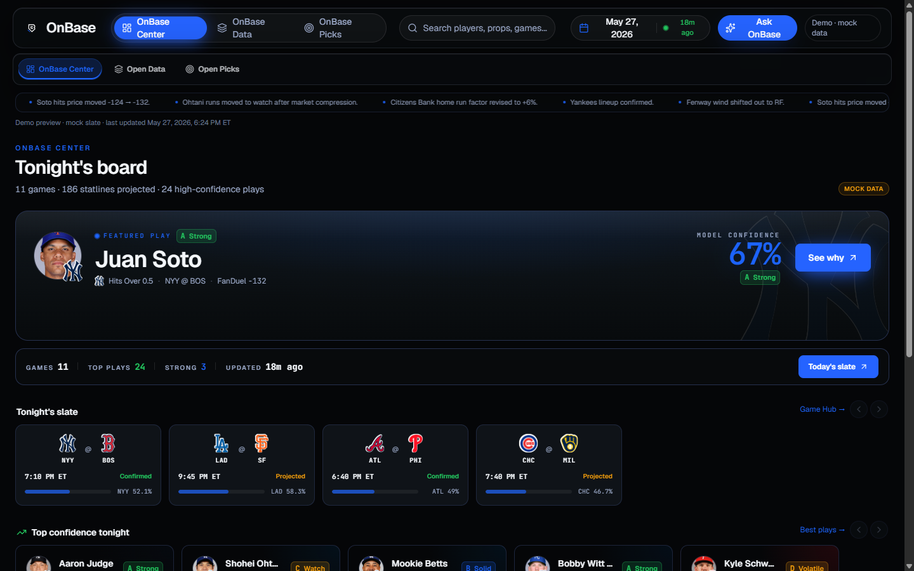
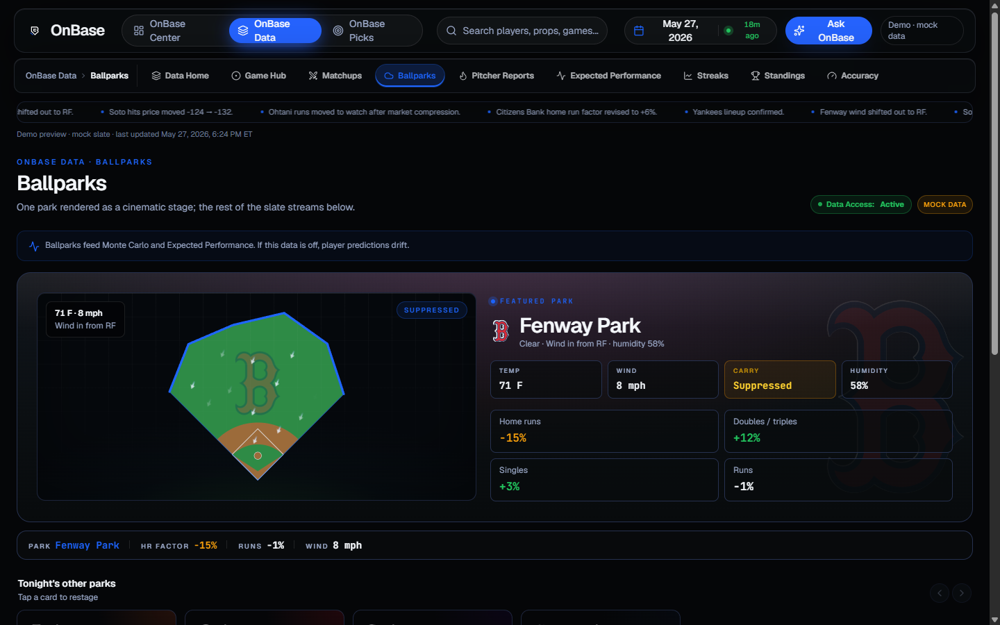
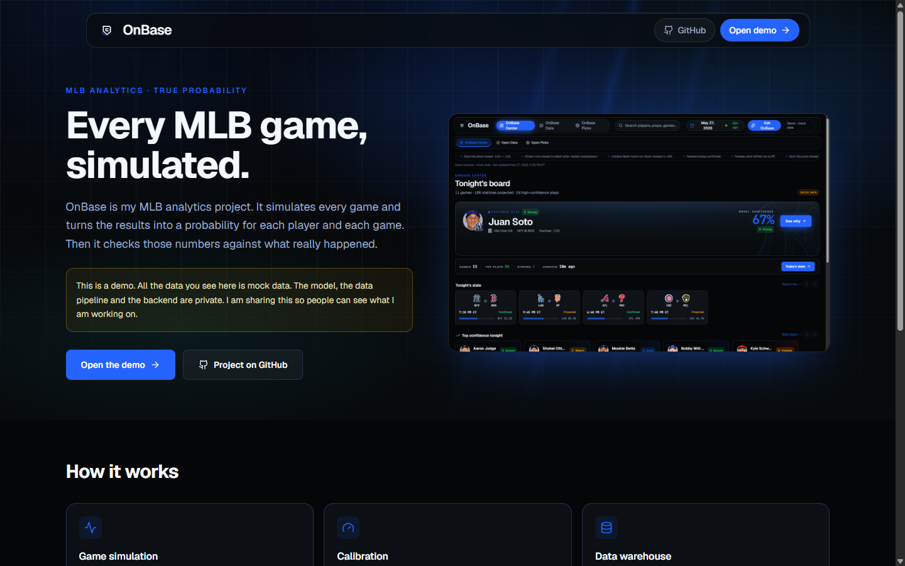

# OnBase

OnBase is my main project. It is an MLB analytics app built on a true probability model. It simulates every game, turns the results into a probability for each player and each game, and then checks those numbers against what really happened.

> This repo is a showcase. The demo uses mock data. The model, the data pipeline and the backend are private. I am sharing this so people can see what I am working on. I am happy to walk through the private code in an interview.

**Live demo:** coming soon



## What it does

- Simulates each MLB game plate appearance by plate appearance, thousands of times.
- Turns the simulations into probabilities for player stats (hits, total bases, strikeouts and more) and for game results.
- Compares the model with market odds after removing the bookmaker margin.
- Checks every probability against the real outcome and recalibrates each market when the model is off.
- Gives each number a grade and the reasons behind it.
- Shows parks, weather, matchups, pitcher reports, streaks and model accuracy in a web app.

The product shows model confidence and a clear grade. It does not promise wins, and AI does not make any of the predictions. The only AI part is an assistant that explains the numbers to the user.



## How it works

```
 MLB Stats API, Baseball Savant, odds feeds
        |
        v
 Data warehouse (pitch level Statcast and box scores, 2016 to today)
        |
        v
 Simulator
   - matchup model for each plate appearance (batter vs pitcher)
   - regression to the mean for small samples
   - batted ball model with park and weather physics
   - 24 state baserunning model
   - Monte Carlo game simulation
        |
        v
 Probabilities for each player and game
        |
        v
 Calibration against real outcomes, per market
        |
        v
 FastAPI backend  -->  React web app
```

A set of scheduled jobs runs the daily cycle. They load lineups and odds, run the simulations, lock predictions before first pitch and grade them after the games end.

## Numbers

- About 422 commits since June 2026.
- About 380,000 lines of Python in about 1,500 files, with 440 test files.
- About 34,000 lines of TypeScript in the web app.
- Warehouse of about 39 GB with pitch level data from 2016 to 2026.

## Tech stack

| Part | Tools |
|---|---|
| Backend and model | Python, FastAPI, NumPy, pandas, SQLite |
| Data extraction | Go |
| Simulation experiments | Julia, Rust |
| Web app | React, TypeScript, Vite, TanStack, Tailwind |
| Auth and infra | Clerk, Supabase, Cloudflare Tunnel |

## Public pieces

Some parts of OnBase are general enough to share on their own.

- [mlb-statcast-extractor](https://github.com/orlrami/mlb-statcast-extractor). The Go tool that downloads Statcast and Stats API data for the warehouse.
- [baseball-math](https://github.com/orlrami/baseball-math). The public formulas I use, like odds conversion, de-vig, ball flight physics and stabilization points.

## What I learned

- Data quality is most of the work. I found columns that were completely empty, wrong game links and future games in the data. Now I check the data before I trust any result.
- A model is only as good as its calibration. Some markets got worse after calibration, so every change has to be tested on real outcomes first.
- Leakage is easy to miss. Every feature only uses data from before the game date.
- Simple and measured beats complex and untested.

## How I built it

I designed and built OnBase myself. I used AI tools like Claude and Codex during development, mostly for code review, research and writing tests. I always checked the results against real data. The design and the decisions are mine.



## Status

In active development. A results write up with calibration plots will come after the 2026 season.

---

Built by [Orlando Ramirez](https://github.com/orlrami).
